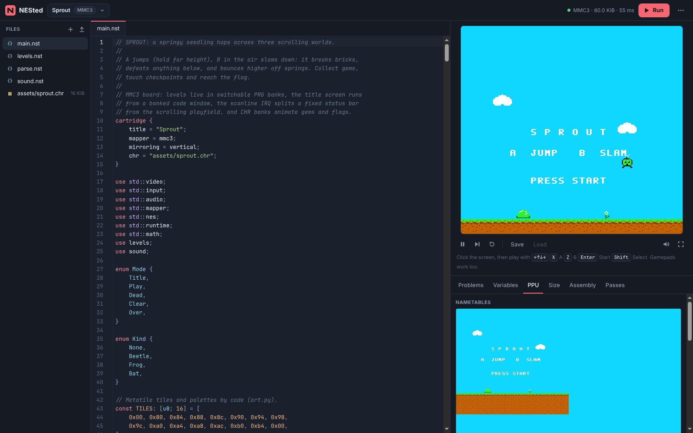
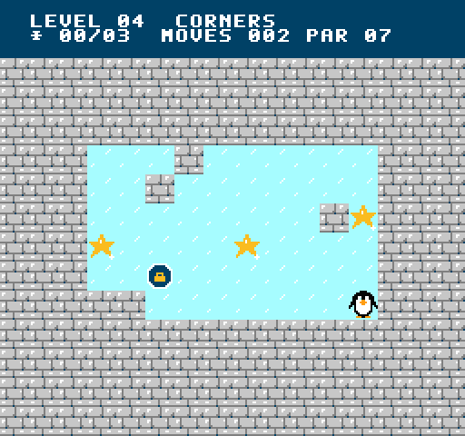
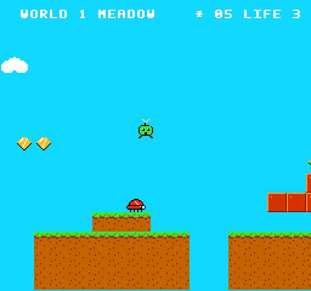
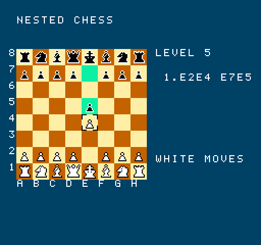

# NESted

**A programming language for the NES.** Structs, enums, modules,
compile-time evaluation and proven array indexing, compiled by a
dependency-free Rust compiler to real iNES cartridges for nine mapper boards.
It comes with a standard library, a formatter, a language server, a VS Code
extension and a browser workbench where every example is a compiled ROM
running in an emulator.

**[Open the playground →](https://nathsou.github.io/NESted/)** ·
[Language guide](docs/language.md) · [Design notes](docs/design.md) ·
[Architecture](docs/architecture.md) · [Embedding the compiler](crates/compiler/README.md)



## Example cartridges

| Glide · CNROM | Sprout · MMC3 | NESted Chess · NROM |
|:---:|:---:|:---:|
|  |  |  |
| An ice-sliding puzzle in 25 levels. You only stop when something stops you: push blocks to make new stopping points, sink them into holes to make bridges, collect every star, then reach the exit. Undo any move, beat each level's par. | A scrolling platformer across three worlds. A jumps (hold for height), B in the air slams down to break bricks, flatten enemies and bounce off springs. Gems, checkpoints, and a status bar held still by the MMC3 scanline IRQ while the world scrolls. | A complete chess engine in 32 KiB of ROM and 2 KiB of RAM. Play the cartridge at eight levels, a friend, or watch it play itself. |

**Controls:** arrows move, **X** is A, **Z** is B, **Enter** is Start,
**Shift** is Select. Click the screen first; gamepads and the on-screen pad
on phones work too.

Each example shows a different side of the hardware. Glide switches 8 KiB CHR
banks to animate water and stars, and keeps an undo log in a range-typed ring
buffer. Sprout stores its levels in switchable 8 KiB PRG banks (they are
parsed from ASCII maps by compile-time functions), runs its title screen from
a banked code window, streams columns of tiles as it scrolls, and splits the
screen with the scanline IRQ. Chess uses recursion with `@recursive`, a
transposition table and a `vblank` hook that keeps the clock and spinner
running while the engine thinks.

### NESted Chess

**D-pad** moves the cursor, **A** picks up and drops a piece, **B** cancels a
selection or makes the engine move now, **Select** flips the board and
**Start** opens the menu. Each side is a human or the cartridge at one of
eight levels, from instant replies to a minute per move.

The engine is a 0x88 board with piece lists, staged pseudo-legal move
generation with cheap pin and check tests, incrementally updated PeSTO
tapered evaluation and Zobrist keys. Search is iterative-deepening PVS with
null-move pruning, late-move reductions, futility pruning, check extensions,
killers, history, a hash table for move ordering and quiescence search, plus
threefold repetition, the fifty-move rule and an opening book built with
Stockfish. It also ponders: while you think it searches the reply it expects.
Measured against Stockfish's `UCI_Elo` levels it plays at about 1700 Elo at
level 5 (10 seconds a move) and about 1800 at level 8.

`crates/chessbench` runs the cartridge headlessly for perft, profiling and a
UCI bridge; `scripts/chess` builds its tables, graphics and book and runs
matches.

## The language in one screen

```nested
cartridge {
    title = "Swarm";
    mapper = uxrom;
    chr = ram;
}

use std::video;
use std::input;
use std::math;
use std::runtime;

enum Kind {
    Bat,
    Slime,
    Ghost,
}
struct Enemy {
    x: u8,
    y: u8,
    kind: Kind,
    hp: u8,
}
type Slot = u8 in 0..16; // a u8 proven to be < 16

var enemies: [Enemy; 16]; // stored field by field
@bank(0) const TILES: [u8; 8192] = asset("assets/tiles.chr");
const WOBBLE: [i8; 32] = wobble(); // computed at compile time

fn wobble() -> [i8; 32] {
    var t: [i8; 32] = [0; 32];
    for i in 0..32 {
        t[i] = math::SIN[i * 8] / 32;
    }
    return t;
}

fn init() {
    video::upload_chr(0, TILES); // switches banks by itself
}

fn update() {
    for i in 0..16 {
        draw(i);
    }
}

fn draw(i: Slot) {
    let e = enemies[i]; // no bounds check needed
    let tile = match e.kind {
        Bat => 0x10,
        Slime => 0x14,
        Ghost => 0x18,
    };
    video::sprite(e.x, e.y + u8(WOBBLE[(runtime::frames + i) & 31]), tile, 0);
}
```

The [language guide](docs/language.md) covers everything: types,
proofs, modules, attributes, interrupts, boards and the standard library.

## Supported boards

NROM, CNROM, UxROM, AxROM, BNROM, GxROM, Color Dreams, MMC1 and MMC3. The
linker places code and data in banks, generates bank-switching trampolines
for calls and reads across banks, replicates shared code on 32 KiB boards,
boots CHR RAM, and avoids bus conflicts. The playground has a starter project
for each board.

## Build

Requires stable Rust with the `wasm32-unknown-unknown` target, Node 24+ and
Python 3 (only to regenerate art and levels).

```sh
npm ci
npm run build        # WASM compiler, native CLI, examples and the playground
npm run dev          # playground at http://localhost:5173
```

```sh
cargo run --release -p nested-cli -- build games/sprout -o sprout.nes --emit out/
cargo run --release -p nested-cli -- run games/glide 600 --input start@90 --shot glide.png
cargo run --release -p nested-cli -- fmt --check games/*/*.nst
npm run package:extension   # VS Code extension with the native language server
```

## Tests

```sh
cargo test --release --workspace   # compiler, differential execution, fuzzing, games
npm test                           # WASM/native parity, audio, LSP
npm run test:browser               # the production playground in Chromium
```

The compiler's execution tests run programs through both the compile-time
interpreter and the emulator and require identical results, optimized and
not; a fuzzer generates random programs for the same comparison. The game
tests play the cartridges with scripted controller input: a bot replays the
par solution of every Glide level, another clears Sprout's first world, and
the chess tests play moves against the engine and check perft counts. Every
frame, they also check that no background update was dropped.

## Repository

| Path | Contents |
|---|---|
| `crates/compiler` | The compiler, standard library, formatter and language server. No dependencies, no I/O. |
| `crates/cli` | The `nested` command and the cartridge tests. |
| `crates/emulator` | The [Nessy](https://github.com/nathsou/nessy) emulator, extended with more mappers and inspection. |
| `crates/runtime` | A small API over the emulator for tools and tests. |
| `crates/wasm` | The compiler, language server and emulator for the browser, behind a plain C ABI. |
| `crates/chessbench` | Headless chess benchmarking and UCI. |
| `games/` | The example projects. |
| `playground/` | The web workbench (Vite, TypeScript 7, CodeMirror 6). |
| `extension/` | The VS Code extension. |
